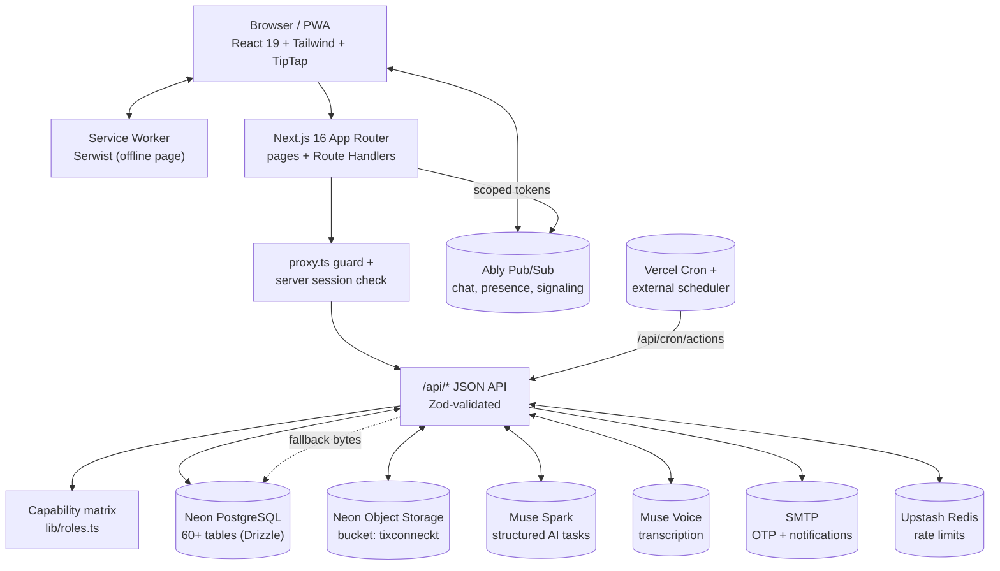
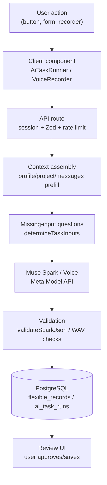
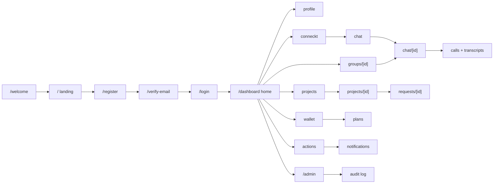

# TIXCONNECKT

> **Turn skills and ideas into work that moves forward.** TIXCONNECKT is a collaboration platform where people, universities, public organizations, and funding/support providers discover each other, shape ideas in shared project workspaces, coordinate through groups and realtime chat, and track requests, agreements, contributions, and wallet activity in one place.

[](https://nextjs.org/)
[](https://react.dev/)
[](https://www.typescriptlang.org/)
[](https://tailwindcss.com/)
[](https://orm.drizzle.team/)
[](https://neon.tech/)
[](https://dev.meta.ai/)
[](https://dev.meta.ai/models/muse-voice-transcribe)
[](https://serwist.serwist.dev/)

**Status:** Active development · `v0.1.0` · Hackathon evaluation build (see [Intellectual Property, Ownership & Usage Restrictions](#intellectual-property-ownership--usage-restrictions))

## Hackathon Submission

> **Meta Global AI Developer Hackathon (Cerebral Valley) — Indie Developer track — Problem statement #1: Build for Your World.**

- **Built 100% during the event** (Oct 28–Nov 2, 2026): every commit falls inside the Oct 27–Nov 4 building window — verify with `git log --date=short --format='%h %ad %s'`. "Copy" in commit messages is the author's daily snapshot-phase label, not copied code (see [Commit History & Originality](#commit-history--originality)).
- **What is new:** full collaboration platform + Meta AI integration: 8 Muse Spark structured tasks, Muse Voice transcription across chat/profile/calls/actions, and a verifiable voice-to-action agent (propose → validate → human approves → cron executes → notify + audit).
- **Meta models (exact):** `muse-spark-1.3` and `muse-voice-transcribe-1.0` via Meta Model API (`dev.meta.ai`); open-weights path supported when `MUSE_OPEN_*` is configured.
- **Hero in one line:** a community organizer speaks a need → transcribed → structured into a project + support request → a provider responds → money and work stay linked. Voice-to-funded-work in minutes.
- **Demo video:** _URL added before submission_ · **Live product:** _URL added before submission_ · **Judge path:** [Usage Guide — Judge path](#judge-path-5-clicks).

<p align="center">
  
</p>

---

## Table of Contents

- [Hackathon Submission](#hackathon-submission)
- [About the Project](#about-the-project)
- [Key Features](#key-features)
  - [Core Features](#core-features)
  - [User-Facing Features](#user-facing-features)
  - [Dashboard Features](#dashboard-features)
  - [Administrative Features](#administrative-features)
  - [Security Features](#security-features)
  - [Integrations](#integrations)
  - [Implemented vs. Planned](#implemented-vs-planned)
- [Dashboard Documentation](#dashboard-documentation)
  - [Dashboard Home](#dashboard-home)
  - [Profile](#profile)
  - [Conneckt](#conneckt)
  - [Chat](#chat)
  - [Matching](#matching)
  - [Wallet](#wallet)
  - [Plan](#plan)
  - [Action](#action)
  - [Notifications](#notifications)
  - [Project Workspace](#project-workspace)
  - [Organizations](#organizations)
  - [Request](#request)
  - [Support Cases](#support-cases)
  - [Groups](#groups)
  - [Settings](#settings)
  - [Admin Overview](#admin-overview)
  - [Admin Users](#admin-users)
  - [Admin Groups](#admin-groups)
  - [Admin Projects](#admin-projects)
  - [Admin Requests](#admin-requests)
  - [Admin Audit Log](#admin-audit-log)
  - [Admin Settings](#admin-settings)
- [Technology Stack](#technology-stack)
- [System Architecture](#system-architecture)
- [AI Architecture & Intelligent Features](#ai-architecture--intelligent-features)
- [Project Structure](#project-structure)
- [Installation and Setup](#installation-and-setup)
- [Environment Variables](#environment-variables)
- [Usage Guide](#usage-guide)
  - [Judge path (5 clicks)](#judge-path-5-clicks)
- [System Tour](#system-tour)
  - [Page Inventory](#page-inventory)
  - [Core User Workflows](#core-user-workflows)
  - [Cross-Page Relationships](#cross-page-relationships)
  - [Commit History & Originality](#commit-history--originality)
- [Screenshots and Demonstrations](#screenshots-and-demonstrations)
- [API Documentation](#api-documentation)
- [Security](#security)
- [Testing](#testing)
- [Deployment](#deployment)
- [Roadmap](#roadmap)
- [Troubleshooting](#troubleshooting)
- [Contribution Policy](#contribution-policy)
- [Intellectual Property, Ownership & Usage Restrictions](#intellectual-property-ownership--usage-restrictions)
- [License](#license)
- [Author and Contact](#author-and-contact)
- [Acknowledgments](#acknowledgments)

---

## About the Project

**Hackathon hero (problem statement #1 — Build for Your World).** A community organizer **speaks a need** → **Muse Voice transcribes it** → **Muse Spark structures it** into a project plus a funding/support request → **a provider responds** → money, documents, decisions, and work stay linked in one trail. This answers the statement directly: Meta's models in a real domain (grassroots collaboration), freeing organizers from forms and tool-hopping, making **voice-to-funded-work in minutes** possible — something that was not possible for them before.

**What it is.** TIXCONNECKT (`tixconneckt`, v0.1.0) is a full-stack Next.js collaboration platform. Members build skill-based profiles, discover collaborators through search and AI-assisted matching, form groups and organizations, run realtime conversations and voice/video calls, manage documents in project workspaces, submit and review funding/support requests, and track wallet, ledger, and contribution records — with administration, moderation, and audit tooling built in.

**The problem it solves.** Independent contributors, institutions, and support providers typically coordinate across disconnected tools: profiles in one place, conversations in another, documents, decisions, funding requests, and payment records scattered everywhere. TIXCONNECKT keeps the whole journey — discover → shape the work → work as a team → coordinate support — connected to the people and projects involved.

**Target audience.**

- Independent contributors with a skill, idea, or time to contribute (`/dashboard/profile`, `/dashboard/conneckt`).
- Universities and public/government organizations (`/dashboard/organizations`).
- Funding (`loan`) and non-financial (`support`) providers (`/dashboard/requests`).
- Groups and project teams coordinating shared work (`/dashboard/groups`, `/dashboard/projects/[id]`).

**Core value proposition.** One account, one workspace model: profile visibility, matching, chat, calls, documents, requests, agreements, decisions, wallets, and audit trails stay linked instead of living in separate silos.

**What makes it different.**

- **Requester-owned projects with provider responses attached** — funding and support decisions stay connected to the work they fund.
- **AI that stays reviewable** — Muse Spark/Voice outputs are validated, provenance-tagged, and saved as flexible records; when AI is unconfigured the UI shows explicit pending states instead of fabricated results.
- **Graceful degradation everywhere** — missing object storage falls back to PostgreSQL byte storage, missing Ably falls back to chat polling, missing AI shows pending states. The app keeps working.
- **Role-aware authorization matrix** (`lib/roles.ts`) with deny-by-default capabilities, plus audit logging and legal-consent gates at registration.

---

## Key Features

### Core Features

- Skill/objective-based **profiles** with visibility controls and shareable short IDs (`/dashboard/profile/[shortId]`).
- **Discovery & matching**: people/organization search plus match suggestions with AI-generated compatibility explanations.
- **Connections (Conneckt)**: connection requests, accept/decline, badge counts.
- **Realtime chat**: threads, message editing, reactions, read/delivery receipts, typing indicators, presence, file attachments, message forwarding, full-text search, per-conversation settings.
- **Voice/video calls**: WebRTC calls with TURN/STUN NAT traversal, server-mediated signaling, consent-gated transcription.
- **Project workspaces**: folders, TipTap rich-text documents, file uploads, version history, exports (PDF/DOCX), shares, member management, activity feed, AI document assistance.
- **Groups & organizations**: membership, roles, approvals, shared conversations, group wallets, organization verification workflows.
- **Requests & support cases**: funding/support requests, provider responses, request conversations, attached files, decisions, agreements.
- **Wallet & ledger**: accounts, contributions, savings goals, withdrawals with provider callbacks and reconciliation, manual review queue, payment-method binding.
- **Scheduled actions & automation**: natural-language instructions interpreted by AI into reviewable scheduled actions, executed by a cron worker with reminders.
- **Notifications**: in-app notification center with delivery tracking.
- **PWA support**: Serwist service worker with an offline page (`/offline`).

### User-Facing Features

- Public landing page with platform, audience, workflow, mission, and privacy sections.
- Registration with legal gates (privacy, terms, agreement documents must be read before acceptance), email OTP verification, login with verification, password recovery.
- Dashboard home with counts/summary endpoints powering navigation badges.
- Plans/subscriptions and provider-eligibility views.
- Flexible records: user-defined structured data (including AI results) stored as validated JSONB.
- Voice capture utilities with browser-audio → WAV conversion for transcription.

### Dashboard Features

15 member dashboards (see [Dashboard Documentation](#dashboard-documentation)): Home, Profile, Conneckt, Chat, Matching, Wallet, Plan, Action, Notifications, Project, Organizations, Request, Support cases, Groups, Settings.

### Administrative Features

7 admin dashboards plus APIs: platform overview, user management, group/project/request moderation queues, audit log, payment oversight, storage reconciliation reads, and admin settings.

### Security Features

- DB-backed sessions with HMAC-signed `HttpOnly` cookies (`__Host-` prefix in production), 30-day TTL, full revocation on password change.
- Email OTP verification for registration and login; password recovery via scoped confirm/request flow.
- Role/capability matrix (`user` / `provider` / `admin`, categories, provider kinds) with deny-by-default.
- Route guards (`proxy.ts` + server-side session validation on every protected page), Zod validation on all API inputs, DOMPurify sanitization for rich text.
- Audit logs + security events, Upstash rate limiting, signed Ably tokens scoped per user, per-session TURN credentials.
- Consent-gated call transcripts; legal-consent records at registration.

### Integrations

| Integration | Purpose | Required? |
|---|---|---|
| Neon PostgreSQL | Primary database | Yes |
| Neon Object Storage (S3-compatible) | File/document/media bytes | No — falls back to PostgreSQL storage |
| Ably Pub/Sub | Realtime chat, presence, call signaling | No — chat falls back to API polling |
| Muse Spark (Meta Model API) | Structured AI tasks | No — pending states shown |
| Muse Voice (Meta Model API) | Audio transcription | No — pending states shown |
| SMTP (Nodemailer) | OTP, notifications, recovery mail | Effectively required for auth flows |
| TURN/STUN | Voice/video calls behind NAT | Needed for reliable calls |
| Upstash Redis | Rate limiting | No — API runs fail-open per project docs |
| TixLPay | Payment webhook verification | Only if payments enabled |
| Vercel Cron + external scheduler | Action worker ticks | Daily backstop built in; 1–5 min external tick recommended |

### Implemented vs. Planned

- **Implemented:** everything listed above, verified against route handlers, components, schema, and tests in this repository.
- **Explicitly unsupported (documented in code, not silently missing):** direct audio summarization (`summarize_audio`) and structured audio extraction (`extract_audio`) — the configured voice service exposes transcription only (`lib/ai-tasks.ts`).
- **Planned:** no roadmap file is published in this repository (see [Roadmap](#roadmap)). Anything not listed here should be treated as unverified.

---

## Dashboard Documentation

All member routes live under `/dashboard/*` and require an authenticated session; all admin routes live under `/admin/*` and require the `admin` role. Navigation is centralized in `lib/routes.ts` (`DASHBOARD_NAV`, `ADMIN_NAV`), and every nav item maps to a real page.

### Dashboard Home

- **Route:** `/dashboard` · **Component:** `components/dashboard/DashboardHome.tsx`
- **Purpose:** command center summarizing the member's activity.
- **Responsibilities:** surfaces counts and summaries so users know where attention is needed.
- **Functionality/actions:** navigate to every section; badge counts (chat, notifications, conneckt) resolve from `GET /api/dashboard/counts`; cards resolve from `GET /api/dashboard/summary`.
- **Access:** any authenticated, active user.

### Profile

- **Routes:** `/dashboard/profile`, `/dashboard/profile/[shortId]` · **APIs:** `/api/profile`, `/api/profile/[shortId]`, `/api/profile/media`, `/api/profile/voice-assist`
- **Purpose:** the member's public working identity.
- **Responsibilities:** objectives, experience, skills, interests, visibility controls, profile media.
- **Actions:** view/edit own profile, upload/remove media, view others via short ID, use voice-assisted / AI field-extraction suggestions (reviewable until saved).
- **Workflows:** AI `profile_interpret` maps explicitly stated details to editable fields; nothing is auto-saved.

### Conneckt

- **Route:** `/dashboard/conneckt` · **API:** `/api/connections` (`GET,POST,PATCH`) · **Components:** `components/conneckt/*`
- **Purpose:** connection-request inbox and network management.
- **Actions:** send, accept, decline, and list connections; count badge feeds the nav.
- **Interactions:** connections unlock chat threads and collaboration visibility.

### Chat

- **Routes:** `/dashboard/chat`, `/dashboard/chat/[id]` · **APIs:** `/api/chat*` (threads, messages, reactions, delivered receipts, presence, typing, settings, files, forward, search, context, summarize, message analyze) · **Components:** `components/chat/*` · **Hooks:** `use-chat.ts`, `use-ably.ts`
- **Purpose:** realtime member messaging.
- **Actions:** send/edit/delete messages, react, forward, attach files, search, adjust per-thread settings, request AI summaries/analysis.
- **AI:** `summarize_conversation`, `summarize_decisions`, `extract_action_items` run on threads the user belongs to.
- **Realtime:** Ably channels with short-lived scoped tokens; polling fallback when Ably is unconfigured.

### Matching

- **Route:** `/dashboard/matching` · **API:** `/api/matching` · **Components:** `components/matching/*` · **Logic:** `lib/matching.ts`
- **Purpose:** collaborator suggestions.
- **Actions:** view suggestions, request AI compatibility explanations (`match_explain`), act on results.
- **Data:** profiles + `matching_profiles` / `match_results` tables.

### Wallet

- **Route:** `/dashboard/wallet` · **APIs:** `/api/wallet*`, `/api/payment-methods*` · **Components:** `components/wallet/*` · **Logic:** `lib/wallet.ts`, `lib/payout.ts`, `lib/tixlpay.ts`
- **Purpose:** money and contribution tracking.
- **Actions:** view account/ledger, bind payment methods, create savings goals, self-fund, request withdrawals, track reviews; group wallet actions for authorized group actors.
- **Workflows:** withdrawals reconcile via provider callback (`POST /api/wallet/withdrawals/callback`); manual reviews queue for flagged items.

### Plan

- **Route:** `/dashboard/plans` · **API:** `/api/plans` · **Components:** `components/plans/*`
- **Purpose:** subscription/entitlement management.
- **Actions:** view plans, subscribe/change (entitlements resolve via `lib/entitlements.ts`).

### Action

- **Route:** `/dashboard/actions` · **APIs:** `/api/actions` (`GET,POST,PATCH`), `/api/actions/interpret` (`POST`), `/api/cron/actions` · **Logic:** `lib/action-interpret.ts`, `lib/action-policy.ts`, `lib/action-worker.ts` · **Components:** `components/actions/*`
- **Purpose:** scheduled-action automation from natural language.
- **Actions:** describe an instruction ("remind me…", "do X at…"), review the AI-interpreted action, confirm/edit, track attempts.
- **Workflows:** `interpret_action` (Spark) → review → `scheduled_actions` row → cron worker executes with reminders. Cron ticks every 1–5 min externally; Vercel daily backstop at 06:00 UTC.

### Notifications

- **Route:** `/dashboard/notifications` · **API:** `/api/notifications` · **Components:** `components/notifications/*`
- **Purpose:** unified activity inbox. Actions: list, mark read, follow through to source objects.

### Project Workspace

- **Routes:** `/dashboard/projects`, `/dashboard/projects/[id]` · **APIs:** `/api/projects*` (CRUD, members, folders, files, versions, uploads, images, shares, workspace, activity, conversations, file assist/export) · **Components:** `components/projects/*`
- **Purpose:** the working space for an idea: documents, files, feedback, revisions, shares.
- **Actions:** create/edit projects, manage members, organize folders, author TipTap documents, upload files, restore versions, export (PDF/DOCX), create shares with preview, follow activity.
- **AI:** project analysis (`project_analysis`), document extraction (`parse_document`), per-file assistance.
- **Interactions:** requests, contributions, reactions, replies, and shares all anchor to the project.

### Organizations

- **Routes:** `/dashboard/organizations`, `/dashboard/organizations/[id]` · **APIs:** `/api/organizations*` · **Components:** `components/organizations/*`
- **Purpose:** institutional presence for universities, government, and other orgs.
- **Actions:** create/manage organizations, handle access requests, manage members, submit/verify organization verification.
- **Access:** member management gated by `org.manage` capability and membership.

### Request

- **Routes:** `/dashboard/requests`, `/dashboard/requests/[id]` · **APIs:** `/api/requests*`, `/api/providers` · **Components:** `components/requests/*`
- **Purpose:** funding/support request lifecycle.
- **Actions:** create requests, attach files, converse on a request thread, providers respond (`provider.loan.respond` / `provider.support.respond`), decisions recorded.
- **Interactions:** requests link to projects; provider links determine queue visibility.

### Support Cases

- **Route:** `/dashboard/support` · **APIs:** `/api/support-requests*` · **Logic:** `lib/support-requests.ts`, `lib/support-request-policy.ts` · **Components:** `components/support/*`
- **Purpose:** non-financial support case tracking with documents and event history.

### Groups

- **Routes:** `/dashboard/groups`, `/dashboard/groups/[id]` · **APIs:** `/api/groups*` · **Components:** `components/groups/*`
- **Purpose:** team coordination: membership, shared conversations, media, approvals, group wallets.
- **Actions:** create/join groups, manage members, approve requests, share media, act on the group wallet (`group.wallet.act`).

### Settings

- **Route:** `/dashboard/settings` · **API:** `/api/settings` · **Components:** `components/settings/*`
- **Purpose:** account preferences and account lifecycle (view/update settings, account deletion flow via `DELETE`).

### Admin Overview

- **Route:** `/admin` · **Component:** `components/admin/AdminOverview.tsx` · **API:** `GET /api/admin/overview`
- **Purpose:** platform health at a glance: user/request/project/payment aggregates. Admin-only.

### Admin Users

- **Route:** `/admin/users` · **Component:** `components/admin/AdminUsers.tsx` · **API:** `GET,PATCH /api/admin/users`
- **Purpose:** user search, role/status management. Gated by `admin.users.manage`.

### Admin Groups

- **Route:** `/admin/groups` · **Purpose:** group oversight and moderation entry point.

### Admin Projects

- **Route:** `/admin/projects` · **Purpose:** project oversight and moderation entry point.

### Admin Requests

- **Route:** `/admin/requests` · **Component:** `components/admin/ModerationQueue.tsx` · **API:** `GET,PATCH /api/admin/moderation`
- **Purpose:** moderation queue for flagged content/requests.

### Admin Audit Log

- **Route:** `/admin/audit` · **Component:** `components/admin/AdminAudit.tsx` · **API:** `GET /api/admin/audit`
- **Purpose:** immutable-visibility audit trail (`audit_logs`, `security_events`).

### Admin Settings

- **Route:** `/admin/settings` · **Component:** `components/admin/AdminSettings.tsx`
- **Purpose:** platform configuration. Related APIs: `GET,PATCH /api/admin/payments`, `GET /api/admin/storage/reconciliation` (storage health reads, `storage.reconcile.read`).

---

## Technology Stack

Verified against `package.json`, configs, and imports — no aspirational entries.

| Category | Technology | Version / Detail |
|---|---|---|
| Framework | Next.js (App Router) | 16.4.3 · `cacheComponents`, `partialPrefetching` |
| UI | React + React DOM | 19.3.0 |
| Language | TypeScript | 5 (`strict` via tsconfig) |
| Styling | Tailwind CSS | 4 (via `@tailwindcss/turbopack`) |
| Icons | FontAwesome (svg-core, solid, react) | 7.3.1 / 3.5.0 |
| Editor | TipTap (StarterKit, Link, Image, Table, TextAlign, Underline, Placeholder) | 3.32.1 |
| Forms | react-hook-form + @hookform/resolvers + Zod | 7.91.0 / 6.0.2 / 4.6.7 |
| PWA | Serwist (`@serwist/next`) | 9.5.13 · `app/sw.ts` → `public/sw.js` |
| Backend | Next.js Route Handlers | 100+ handlers under `app/api` |
| ORM | Drizzle ORM + drizzle-kit | 0.45.4 / 0.31.11 |
| Database | PostgreSQL (Neon pooled + direct) via `pg` | pg 8.23.1 |
| Auth | Custom sessions (Drizzle + `jose` + HMAC cookies) | jose 6.2.13 |
| Realtime | Ably Pub/Sub | ably 2.30.0 |
| Calls | Native WebRTC + TURN/STUN | `lib/webrtc.ts`, `/api/calls/ice` |
| AI text | Muse Spark via Meta Model API (OpenAI-compatible Chat Completions) | Default `muse-spark-1.3` |
| AI voice | Muse Voice transcription (file + realtime WS) | Default `muse-voice-transcribe-1.0` |
| Storage | AWS SDK v3 S3 client → Neon Object Storage | 3.1161.0 · bucket `tixconneckt` |
| Email | Nodemailer (SMTP) | 10.2.1 |
| Rate limiting | Upstash Redis + Ratelimit | 1.40.0 / 2.2.0 |
| Dates/phones | date-fns, date-fns-tz, libphonenumber-js, world-countries | see `package.json` |
| Exports | jsPDF, docx, isomorphic-dompurify | PDF/DOCX + sanitization |
| Testing | Vitest (unit), Playwright (e2e) | 5.0.5 / 1.64.1 |
| Tooling | ESLint 9 + eslint-config-next, Prettier, tsx, dotenv | see `package.json` |
| Hosting | Vercel (Cron + serverless) | `vercel.json` |

---

## System Architecture

**Overview.** TIXCONNECKT is a monolithic full-stack Next.js application: React Server Components + client components render the UI, Route Handlers expose a session-authenticated JSON API, Drizzle ORM persists to Neon PostgreSQL, and edge-friendly services (Ably, Muse, SMTP, S3-compatible storage) attach over HTTPS/WSS. There is no separate backend server or realtime server to host.



**Data flow (typical authenticated request).**

1. Browser calls a page or `/api/*` endpoint with the session cookie.
2. `proxy.ts` checks cookie presence for `/dashboard/*` and `/admin/*`; the page/handler then validates the session server-side (`lib/session.ts`, `lib/auth-session.ts`).
3. The handler resolves the actor (`actorFromSession`) and checks capabilities (`lib/roles.ts`), validates input with Zod, and applies rate limits.
4. Reads/writes go through Drizzle to PostgreSQL; file bytes prefer object storage with a PostgreSQL fallback; side effects fan out to Ably (realtime events), SMTP (mail), Muse (AI), and audit tables.
5. JSON responses use the shared `apiOk`/`apiError` envelope (`lib/api-response.ts`).

**Component relationships.**

- `app/` — routes only; business logic lives in `lib/`, data access in `db/`.
- `components/` — feature-grouped UI (`chat`, `projects`, `wallet`, …) plus shared `ui/` and `layout/`.
- `lib/` — 50+ domain modules (auth, chat, calls, wallet, matching, storage, AI, email, …); `lib/muse/*` owns all AI transport.
- `db/schema/` — 8 schema files (`auth`, `social`, `chat`, `wallet`, `plans`, `projects`, `flexible`, `system`).
- `hooks/` — realtime/chat/call/voice client hooks.
- `tests/` + `e2e/` — Vitest suites + Playwright smoke journeys.

**Authentication & authorization.** Email/password + OTP verification; DB-backed sessions with HMAC-signed HttpOnly cookies; `users.role` (`user`/`provider`/`admin`), `users.category` (individual/university/government/provider), and `users.providerKind` (`loan`/`support`) feed a deny-by-default capability matrix.

**State management.** Server Components + `fetch` to Route Handlers via `lib/api-client.ts`; realtime state via Ably hooks (`use-ably`, `use-chat`, `use-call-signaling`); no global client store.

---

## AI Architecture & Intelligent Features

AI is **verified as actively implemented** — not merely imported. All transport lives in `lib/muse/` (`spark.ts`, `voice.ts`, `realtime.ts`, `endpoints.ts`, `wav.ts`), facades in `lib/ai.ts`, task definitions in `lib/ai-tasks.ts`, and execution routes under `/api/ai/*`, `/api/actions/interpret`, `/api/chat/[id]/summarize`, `/api/chat/[id]/messages/[messageId]/analyze`, `/api/profile/voice-assist`, and `/api/projects/[id]/files/[fileId]/assist`.

**The agentic centerpiece is a verifiable voice-to-action agent** (multimodal input, verifiable execution): a user speaks or types an instruction → Muse Voice/Spark proposes a structured action → the server validates it → the human reviews and approves → the cron worker executes → notification + `action_attempts`/audit rows record the outcome. Every step is inspectable; nothing executes without approval and nothing fabricates results when AI is unconfigured.

### AI Technologies Used

- **Muse Spark** — structured text tasks over the Meta Model API (`POST …/v1/chat/completions`, OpenAI-compatible). Default model `muse-spark-1.3`, overridable via `MUSE_SPARK_MODEL`.
- **Muse Voice** — transcription over `…/v1/asr/transcribe` (file) and `wss://…/v1/asr/realtime` (streaming). Default model `muse-voice-transcribe-1.0`, overridable via `MUSE_VOICE_MODEL`. **Transcription only** — audio summarization/extraction tasks are explicitly marked unsupported.
- Endpoint base URLs self-normalize (bare host, versioned root, or full operation URL) to prevent path doubling (`lib/muse/endpoints.ts`, covered by `tests/muse-endpoints.test.ts`).
- **Open weights (opt-in):** matching tasks (`match_explain`, `match_score`) can run on Meta open-weights models (default `meta-models/muse-spark-open-1026`) via OpenAI-compatible partner inference (`lib/muse/openweights.ts`, covered by `tests/muse-openweights.test.ts`). Active only when `MUSE_OPEN_API_URL` + `MUSE_OPEN_API_KEY` are set and `MUSE_OPEN_MATCH=1`; any failure falls back to Spark, and the actual model id is recorded in record provenance (`model`) and match rationales (`AI note [model]: …`). Requires partner credits/keys — without them the path stays off and behavior is identical to Spark-only.

### AI-Powered Features

| AI Feature | Trigger | Provider/Model | Input | Output | Destination |
|---|---|---|---|---|---|
| Project analysis | User runs task on a project | Spark | Goal + context (+ project data prefill) | Validated JSON doc | Flexible record + UI render |
| Match explanation | User requests on a match | Spark | Two profile descriptions | Compatibility explanation | Chat/matching UI |
| Document extraction | User runs task on a document | Spark | Goal + document content | Extracted fields/JSON | Flexible record + UI |
| Action interpretation | User submits instruction | Spark | Natural-language instruction | Reviewable scheduled action | `scheduled_actions` (after review) |
| Profile field extraction | User pastes details | Spark | Free-text details | Field-mapped suggestions | Review UI (saved only on user save) |
| Conversation summary | Member requests in thread | Spark | Recent messages + optional focus | Summary | Chat UI (+ optional record) |
| Decision summary | Member requests in thread | Spark | Recent messages | Organized decisions | Chat/group UI |
| Action items | Member requests in thread | Spark | Recent messages | Follow-up list | Chat UI |
| Voice transcription | User records/uploads audio | Voice | Mono 16-bit WAV @16/24 kHz | Transcript (+ turns) | Chat/profile/call transcript UI |
| Call transcription | Consented call recording | Voice | Converted call audio | Transcript | `call_transcripts` (consent-gated) |

### When AI Is Activated

AI **never runs spontaneously**. Every execution is user-initiated (button/task run), runs through an authenticated API route, and — for anything persisted — passes validation first. No dashboard auto-invokes AI on load; no background job calls AI except the action worker executing already-reviewed actions.

### How AI Works



**Pipeline detail.**

1. Client collects values (`values` incl. prefill + answers) and posts to `/api/ai/process` (Spark) or `/api/ai/voice` (Voice).
2. Server validates session, rate limit (20 AI requests / 10 min for process), task ID + supported flag, field names/values, and doc size.
3. `callMuseSpark` / `transcribeWithMuseVoice` invoke the configured endpoint with server-side Bearer keys.
4. Spark JSON is validated generically (plain object, bounded size/depth, no prototype-pollution keys); audio must be mono 16-bit WAV (clients convert via `lib/audio-convert.ts`).
5. Results persist as flexible records with run provenance (`ai_task_runs`, model id via `sparkModelId()`), and the UI renders the saved record — never an assumed shape.

### AI Input and Output

- **Spark in:** `{ task, input, schemaHint?, outputSchema? }`. **Out:** `{ configured, data? | error?, model? }`, or `{ configured: false, pendingReason }`.
- **Voice in:** WAV `Blob` + filename + `{ mode, languageBias?, keywords? }`. **Out:** `{ configured, transcript?, turns?, error? }`, or pending when unconfigured.

### AI Result Delivery

Immediate (request/response) for all tasks; realtime streaming only for voice sessions (`/api/ai/voice/stream`, `use-voice-recorder`). Delivery surfaces: dashboard UIs, API responses, persisted records/transcripts, and call-transcript views. Failed/unconfigured calls return explicit errors or pending states — **never fabricated AI output**.

### AI Data Flow

Only the task payload (user input + relevant context such as profile/project fields or thread messages) is sent to the Meta endpoints; credentials stay server-side; prompts/responses are validated and may persist as records/transcripts for the owning user/project. No anonymization layer is implemented — do not submit data you would not share with the configured provider.

### AI Environment Configuration

`MUSE_SPARK_API_URL`, `MUSE_SPARK_API_KEY`, `MUSE_SPARK_MODEL` (optional), `MUSE_VOICE_API_URL`, `MUSE_VOICE_API_KEY`, `MUSE_VOICE_MODEL` (optional). All server-private (no `NEXT_PUBLIC_` prefix). Missing URL/key ⇒ `aiSparkConfigured()`/`aiVoiceConfigured()` return false and features show pending states.

### AI Security and Privacy

Server-side keys only; per-request auth + rate limits; output validation before persistence; consent-gated call transcripts; no secrets in prompts. No compliance certification is claimed.

### Error Handling and Limitations

502 with preserved input on provider failure; 501 for unsupported voice tasks; pending responses when unconfigured; WAV-format rejection with actionable guidance; bounded JSON acceptance. No fallback model chain is implemented. Human review is required before AI outputs become actions, profile data, or shared records.

### AI Usage and Cost Considerations

Token usage, pricing, and quotas depend entirely on the operator's Meta Model API plan — the codebase does not meter tokens or estimate cost. Rate limits (e.g. 20 process calls / 10 min / user) bound abuse but are not cost controls.

---

## Project Structure

```text
tixconneckt/
├── app/                    # Next.js App Router: pages + API routes
│   ├── page.tsx            # Landing page / auth redirect entry
│   ├── layout.tsx          # Root layout
│   ├── sw.ts               # PWA service-worker source
│   ├── login/ register/ verify-email/ forgot-password/ reset-password/
│   ├── legal/[type]/       # Privacy / terms / agreement
│   ├── offline/            # Offline fallback page
│   ├── dashboard/          # 15 member dashboards (see docs above)
│   ├── admin/              # 7 admin dashboards
│   └── api/                # 100+ Route Handlers (auth, chat, calls, AI, ...)
├── components/             # Feature-grouped UI (29 groups: chat, wallet, ai, ...)
├── lib/                    # 50+ domain modules + lib/muse/* AI transport
├── db/                     # Drizzle: schema/*, index, migrations, seed, preflight
├── hooks/                  # use-ably, use-chat, use-call-*, use-voice-recorder, ...
├── e2e/                    # Playwright smoke journeys
├── tests/                  # 34 Vitest suites
├── public/                 # logo.png, generated sw.js
├── Specification/          # Product/design working notes (not user docs)
├── proxy.ts                # Lightweight route guard for /dashboard, /admin
├── instrumentation.ts      # Boot-time idempotent auto-migration
├── drizzle.config.ts       # Drizzle Kit (PostgreSQL, db/schema)
├── next.config.ts          # Next.js + Serwist config
├── vercel.json             # Daily cron backstop + function limits
├── vitest.config.ts  playwright.config.ts  eslint.config.mjs
└── package.json            # Scripts, dependencies
```

Excluded: `node_modules/`, `.next/`, `.git/`, caches, and generated files.

---

## Installation and Setup

### Prerequisites

- **Node.js** 22+ (see `@types/node` ^22) and **npm** (repo uses `package-lock.json`).
- **PostgreSQL** — Neon recommended (pooled URL for runtime, direct URL for migrations). Any PostgreSQL reachable via `DATABASE_URL` works for local dev.
- Optional: SMTP credentials (email OTP), Ably key (realtime), TURN server (calls), Muse keys (AI), Upstash Redis (rate limits), Neon Object Storage (file bytes).

### 1. Clone and install

```bash
git clone <repository-url>
cd tixconneckt
npm install
```

Windows PowerShell uses the same commands; macOS/Linux identical.

### 2. Configure environment

No `.env.example` is shipped. Create your local env file manually with at least the required keys (placeholders only — never commit real values):

```bash
cp .env .env.local  # if you keep a template, or create .env.local from scratch
```

Required for boot (`lib/config.ts` throws otherwise):

```env
DATABASE_URL=postgresql://<user>:<password>@<host>/<db>?sslmode=require
AUTH_SECRET=<openssl-rand-hex-32-output-min-32-chars>
NEXT_PUBLIC_APP_URL=http://localhost:3000
```

Generate the secret: `openssl rand -hex 32`.

Full variable reference: [Environment Variables](#environment-variables).

### 3. Database

```bash
npm run db:migrate   # preflight + drizzle-kit migrate (uses DATABASE_URL_DIRECT when set)
npm run db:seed      # seed data (tsx db/seed.ts)
```

Notes:

- The server also auto-applies pending migrations on boot via `instrumentation.ts` (idempotent, advisory-locked, failure only logs). Set `SKIP_AUTO_MIGRATE=1` to manage migrations externally.
- Useful: `npm run db:push` (push schema), `npm run db:studio` (inspect data).

### 4. Start the development server

```bash
npm run dev
```

Open `http://localhost:3000`. Verify liveness: `GET /api/health` returns `{ service, time, configured, missing }`.

### 5. Create the admin account

Register normally in the UI, then set `role = 'admin'` on that user row in the database before signing in.

### Scripts

| Script | Command | Purpose |
|---|---|---|
| `dev` | `next dev` | Development server |
| `build` | `next build` | Production build |
| `start` | `next start` | Serve production build |
| `lint` | `eslint .` | Lint |
| `typecheck` | `tsc --noEmit` | Type check |
| `test` | `vitest run` | Unit suite |
| `test:watch` | `vitest` | Unit suite (watch) |
| `test:e2e` | `playwright test` | E2E smoke journeys |
| `db:generate` | `drizzle-kit generate` | Generate migration |
| `db:migrate` | `node db/preflight.mjs && drizzle-kit migrate` | Apply migrations |
| `db:push` | `node db/preflight.mjs && drizzle-kit push` | Push schema |
| `db:studio` | `node db/preflight.mjs && drizzle-kit studio` | DB browser |
| `db:seed` | `tsx db/seed.ts` | Seed data |

---

## Environment Variables

Every name below is referenced in code. Values shown are placeholders/shapes only. `NEXT_PUBLIC_*` keys are baked into the client build — changing them requires a rebuild/redeploy.

| Variable | Description | Required | Example / Where to get |
|---|---|---|---|
| `DATABASE_URL` | Runtime DB connection (Neon pooled URL) | Yes | Neon console → pooled connection string |
| `DATABASE_URL_DIRECT` | Direct (non-pooled) URL for migrations | No | Neon console → direct connection string |
| `AUTH_SECRET` | Session HMAC secret (32+ chars) | Yes | `openssl rand -hex 32` |
| `NEXT_PUBLIC_APP_URL` | Public app origin, no trailing slash | Yes | `http://localhost:3000` / production domain |
| `SMTP_HOST` / `SMTP_PORT` | SMTP server | For email | `smtp.gmail.com` / `465` |
| `SMTP_USER` / `SMTP_PASS` | SMTP credentials | For email | Mail provider / app password |
| `SMTP_FROM` | From header | No | `TIXCONNECKT <no-reply@tixconneckt.com>` |
| `MAIL_REPLY_TO` | Reply-To header | No | Monitored inbox |
| `NEON_STORAGE_BUCKET` | Object-storage bucket | No | `tixconneckt` (default) |
| `AWS_REGION` | Storage region | For object storage | Neon storage region, e.g. `us-east-1` |
| `AWS_ENDPOINT_URL_S3` | Storage endpoint | For object storage | Neon console endpoint URL |
| `AWS_ACCESS_KEY_ID` / `AWS_SECRET_ACCESS_KEY` | Storage credentials | For object storage | Neon storage key with `storage:write` |
| `ABLY_API_KEY` | Ably private key (server-only) | No | Ably dashboard |
| `NEXT_PUBLIC_TURN_URLS` | TURN URLs (comma-separated) | For calls | TURN provider |
| `TURN_USERNAME` / `TURN_PASSWORD` | TURN credentials (server-only) | For calls | TURN provider |
| `NEXT_PUBLIC_STUN_URLS` | STUN URLs (comma-separated) | No | e.g. `stun:stun.l.google.com:19302` |
| `CRON_SECRET` | Action-worker bearer secret (32+ chars) | For cron | Generate locally |
| `TIXLPAY_WEBHOOK_SECRET` | Payment webhook secret | If payments enabled | TixLPay dashboard |
| `UPSTASH_REDIS_REST_URL` / `UPSTASH_REDIS_REST_TOKEN` | Rate-limit store | No | Upstash console |
| `MUSE_SPARK_API_URL` / `MUSE_SPARK_API_KEY` | AI text endpoint + key | For AI text | Meta Model API (`dev.meta.ai`) |
| `MUSE_SPARK_MODEL` | Spark model override | No | Default `muse-spark-1.3` |
| `MUSE_VOICE_API_URL` / `MUSE_VOICE_API_KEY` | AI voice endpoint + key | For transcription | Meta Model API (`dev.meta.ai`) |
| `MUSE_VOICE_MODEL` | Voice model override | No | Default `muse-voice-transcribe-1.0` |
| `MUSE_OPEN_API_URL` / `MUSE_OPEN_API_KEY` | Open-weights endpoint + key | For open-weights matching | Partner base, e.g. Baseten `https://inference.baseten.co/v1` |
| `MUSE_OPEN_MODEL` | Open-weights model override | No | Default `meta-models/muse-spark-open-1026` |
| `MUSE_OPEN_MATCH` | `1` routes matching tasks to open weights | No | Off unless `1`; falls back to Spark on failure |
| `DB_POOL_MAX` | pg pool size per instance | No | Default `10` |
| `DB_CONNECT_TIMEOUT_MS` | Pool connect timeout | No | Default `10000` |
| `DB_IDLE_TIMEOUT_MS` | Pool idle timeout | No | Default `30000` |
| `DB_STATEMENT_TIMEOUT_MS` | Statement timeout | No | Default `30000` |
| `SKIP_AUTO_MIGRATE` | `1` disables boot migration | No | Only if migrating manually |

`.gitignore` excludes `.env*` (including `.env.local`). `NODE_ENV=production` is set by the host — do not add it manually.

---

## Usage Guide

1. **Start**: `npm run dev` → open the app URL → check `GET /api/health`.
2. **Visitors** land on `/` (landing page). Sign-in and registration live behind its buttons; legacy `/welcome` redirects here.
3. **Register**: read each legal document to unlock its checkbox, submit, then verify the emailed OTP. Login follows with its own verification step; `resend-otp` and password recovery are available.
4. **Members** land on `/dashboard`. The sidebar covers Profile, Conneckt, Chat, Matching, Wallet, Plan, Action, Notifications, Project, Organizations, Request, Support cases, Groups, Settings.
5. **Providers** register with `category=provider` and a kind (`loan`/`support`) determining their queue and response workflow.
6. **Admins** use `/admin/*` (Overview, Users, Groups, Projects, Requests, Audit log, Settings).
7. **Key flows**: connect → chat/call → create or join a project → invite groups/orgs → submit requests → providers respond → track wallet/contributions; use Actions for reminders/automation and Matching + AI explanations to find collaborators.

### Judge path (5 clicks)

For hackathon evaluators on the live product (test accounts supplied in the submission):

1. Sign in as the demo organizer → open `/dashboard/actions`.
2. Record (or paste) the voice note: "Remind the team to review Ada's request tomorrow at 9am" → review the AI-interpreted draft → confirm.
3. Watch it execute on the next worker tick → check the confirmation in `/dashboard/notifications`.
4. Open `/dashboard/projects/[id]` → run project analysis → attach the result to `/dashboard/requests/[id]`.
5. As the demo provider, respond to the request → verify the trail in `/dashboard/wallet` and `/admin/audit`.

---

## System Tour

A guided map of the whole application as one interconnected system: every page, the workflows that connect them, and how to verify them. Figures below were inventoried from the App Router (`app/`), navigation map (`lib/routes.ts`), page components (`components/`), and the API calls each component makes.

> **Want the hands-on version?** Follow [Internal Testing Tour](internal%20testing%20tour.md) — a step-by-step QA walkthrough (stops, checks, expected results, API/DB cross-checks, and a results log) built from this same inventory.

### Page Inventory

33 page files, 3 layouts (`app/layout.tsx`, `app/dashboard/layout.tsx`, `app/admin/layout.tsx`), resolving to 37+ routes. Roles: **Public** (no session), **Member** (any active session), **Provider** (member with provider category/kind), **Admin**.

**Public pages**

| Page | Route | Source file | Main component | Key APIs / tables |
|---|---|---|---|---|
| Landing | `/` | `app/page.tsx` | `site/LandingPage` | Redirects active sessions to dashboards; copy from `lib/site-content.ts` |
| Login | `/login` | `app/login/page.tsx` | `auth/LoginForm` + `OtpForm` | `/api/auth/login`, `/api/auth/verify-login` → `users`, `sessions`, `otp_challenges` |
| Register | `/register` | `app/register/page.tsx` | `auth/RegisterForm` | `/api/auth/register`, `/api/meta/countries`, `/api/legal/*` → `users`, `profiles`, `legal_consents` |
| Verify email | `/verify-email` | `app/verify-email/page.tsx` | `auth/OtpForm` | `/api/auth/verify-registration`, `/api/auth/resend-otp` → `otp_challenges` |
| Forgot password | `/forgot-password` | `app/forgot-password/page.tsx` | `auth/ForgotPasswordForm` | `/api/auth/recovery/request` → `otp_challenges` |
| Reset password | `/reset-password` | `app/reset-password/page.tsx` | `auth/ResetPasswordForm` + `OtpForm` | `/api/auth/recovery/confirm` → `users`, `sessions` (revocation) |
| Legal document | `/legal/privacy`, `/legal/terms`, `/legal/agreement` | `app/legal/[type]/page.tsx` | Static `lib/legal-content.ts` + `/api/legal/[type]` modal variant | `/api/legal/[type]` → `legal_documents` |
| Welcome (legacy) | `/welcome` | `app/welcome/page.tsx` | — (redirect) | Redirects to `/` |
| Offline | `/offline` | `app/offline/page.tsx` | Static fallback | Serwist PWA fallback |
| Not found | `*` | `app/not-found.tsx` | Static 404 | — |

**Member pages** (all under `/dashboard/*`, `proxy.ts` + server session guard)

| Page | Route | Source file | Main component | Key APIs / tables |
|---|---|---|---|---|
| Home | `/dashboard` | `app/dashboard/page.tsx` | `dashboard/DashboardHome` | `/api/dashboard/summary`, `/api/dashboard/counts` (badges) |
| Own profile | `/dashboard/profile` | `app/dashboard/profile/page.tsx` | `profile/OwnProfilePage` | `/api/profile`, `/api/profile/media`, `/api/profile/voice-assist` → `users`, `profiles`, `profile_media` |
| Public profile | `/dashboard/profile/[shortId]` | `app/dashboard/profile/[shortId]/page.tsx` | `profile/UserProfilePage` | `/api/profile/[shortId]`, `/api/connections` |
| Conneckt | `/dashboard/conneckt` | `app/dashboard/conneckt/page.tsx` | `conneckt/ConnecktPage` | `/api/connections`, `/api/discovery`, `/api/providers` → `connections` |
| Chat list | `/dashboard/chat` | `app/dashboard/chat/page.tsx` | `chat/ChatListPage` + `ConversationPanel` | `/api/chat`, `/api/chat/search`, `/api/groups`, `/api/providers` |
| Chat thread | `/dashboard/chat/[id]` | `app/dashboard/chat/[id]/page.tsx` | `chat/ChatThreadPage` + `ThreadView` | `/api/chat/[id]/messages*`, `/presence`, `/typing`, `/summarize`, `/forward`, `…/analyze`, `/api/calls*`, Ably live |
| Matching | `/dashboard/matching` | `app/dashboard/matching/page.tsx` | `matching/MatchingPage` | `/api/matching` (+ Spark `match_explain`) → `matching_profiles`, `match_results` |
| Wallet | `/dashboard/wallet` | `app/dashboard/wallet/page.tsx` | `wallet/WalletPage` (+ `ReviewQueue`, `WithdrawPanel`, `DepositIntake`) | `/api/wallet*`, `/api/documents*`, `/api/wallet/reviews*` → `wallets`, `ledger_entries`, `withdrawals`, `savings_goals` |
| Plan | `/dashboard/plans` | `app/dashboard/plans/page.tsx` | `plans/PlansPage` + `PaymentMethods` | `/api/plans`, `/api/payment-methods` → `plans`, `subscriptions`, `payment_methods` |
| Action | `/dashboard/actions` | `app/dashboard/actions/page.tsx` | `actions/ActionsPage` | `/api/actions`, `/api/actions/interpret` (+ Spark), `/api/chat` → `scheduled_actions`, `action_attempts` |
| Notifications | `/dashboard/notifications` | `app/dashboard/notifications/page.tsx` | `notifications/NotificationsPage` | `/api/notifications` → `notifications`, `notification_deliveries` |
| Projects | `/dashboard/projects` | `app/dashboard/projects/page.tsx` | `projects/ProjectsPage` | `/api/projects` → `projects` |
| Project workspace | `/dashboard/projects/[id]` | `app/dashboard/projects/[id]/page.tsx` | `projects/WorkspacePage` (+ `DocEditor`, `AssistantPanel`, dialogs) | `/api/projects/[id]/*` (workspace, members, folders, files, versions, uploads, images, shares, assist, export, activity) → `project_*`, `documents` |
| Organizations | `/dashboard/organizations` | `app/dashboard/organizations/page.tsx` | `organizations/OrganizationsPage` | `/api/organizations`, `/api/documents`, `/api/profile` → `organizations` |
| Organization detail | `/dashboard/organizations/[id]` | `app/dashboard/organizations/[id]/page.tsx` | `organizations/OrganizationDetailPage` | `/api/organizations/[id]*` (members, verify) → `organization_members`, `organization_verifications`, `organization_access_requests` |
| Requests | `/dashboard/requests` | `app/dashboard/requests/page.tsx` | `requests/RequestsPage` | `/api/requests`, `/api/providers`, `/api/projects?mine=1` → `funding_requests`, `provider_links` |
| Request detail | `/dashboard/requests/[id]` | `app/dashboard/requests/[id]/page.tsx` | `requests/RequestDetailPage` | `/api/requests/[id]*` (responses, conversation, files), `/api/organizations`, `/api/documents/*/url` |
| Support cases | `/dashboard/support` | `app/dashboard/support/page.tsx` | `support/SupportRequestsPage` | `/api/support-requests*`, `/api/projects`, `/api/groups`, `/api/providers?kind=support` → `support_requests`, `support_request_events`, `support_request_documents` |
| Groups | `/dashboard/groups` | `app/dashboard/groups/page.tsx` | `groups/GroupsPage` | `/api/groups`, `/api/groups/[id]/join` → `groups`, `group_members` |
| Group detail | `/dashboard/groups/[id]` | `app/dashboard/groups/[id]/page.tsx` | `groups/GroupDetailPage` + `GroupProfileMedia` | `/api/groups/[id]*` (members, media), `/api/chat` → `group_members`, `group_approvals`, `group_media` |
| Settings | `/dashboard/settings` | `app/dashboard/settings/page.tsx` | `settings/SettingsPage` | `/api/settings` → `users`, `sessions` |

**Admin pages** (all under `/admin/*`, `admin` role required)

| Page | Route | Source file | Main component | Key APIs / tables |
|---|---|---|---|---|
| Overview | `/admin` | `app/admin/page.tsx` | `admin/AdminOverview` | `/api/admin/overview` (aggregates) |
| Users | `/admin/users` | `app/admin/users/page.tsx` | `admin/AdminUsers` | `/api/admin/users` → `users` |
| Groups | `/admin/groups` | `app/admin/groups/page.tsx` | `admin/ModerationQueue` | `/api/admin/moderation` |
| Projects | `/admin/projects` | `app/admin/projects/page.tsx` | `admin/ModerationQueue` | `/api/admin/moderation` |
| Requests | `/admin/requests` | `app/admin/requests/page.tsx` | `admin/ModerationQueue` | `/api/admin/moderation` |
| Audit log | `/admin/audit` | `app/admin/audit/page.tsx` | `admin/AdminAudit` | `/api/admin/audit` → `audit_logs`, `security_events` |
| Settings | `/admin/settings` | `app/admin/settings/page.tsx` | `admin/AdminSettings` | `/api/admin/payments`, `/api/health` (+ `/api/admin/storage/reconciliation` via API) |

### Core User Workflows

Real end-to-end paths assembled from the inventory (each step names the actual route):

1. **Join & verify** — `/` → `/register` (read 3 legal docs → checkboxes unlock → submit) → `/verify-email` (OTP) → `/login` (credentials + verification) → `/dashboard`.
2. **Become visible & connect** — `/dashboard/profile` (complete objectives/skills, avatar) → `/dashboard/conneckt` (discover, send request) → other member accepts → `/dashboard/profile/[shortId]` cross-links.
3. **Message & meet** — `/dashboard/chat` (new thread) → `/dashboard/chat/[id]` (send, react, attach, forward, AI summary) → start call → consent → transcript.
4. **Shape the work** — `/dashboard/projects` (create) → `/dashboard/projects/[id]` (folders, TipTap docs, uploads, versions, shares, members, activity) → AI assist / analysis / export.
5. **Team up** — `/dashboard/groups` (create/join) → `/dashboard/groups/[id]` (members, approvals, media, group wallet) → linked `/dashboard/chat/[id]` thread.
6. **Get support** — project → `/dashboard/requests` (create, attach) → `/dashboard/requests/[id]` (provider responds, conversation, decision) → `/dashboard/support` for non-financial cases.
7. **Money trail** — `/dashboard/wallet` (self-fund with proof → goals → withdrawals → reviews) → `/dashboard/plans` (subscriptions, payment methods).
8. **Automate** — `/dashboard/actions` (describe instruction → AI interpretation → review → schedule) → cron worker executes → `/dashboard/notifications` confirms.
9. **Govern** — `/admin/*`: overview → users/roles → moderation queues → audit log → settings/payments/storage health.

### Cross-Page Relationships

| Source page | Action | Destination page | Expected result |
|---|---|---|---|
| `/` | Authenticated visit | `/dashboard` or `/admin` | Role-based redirect, no landing flash |
| `/register` | Submit valid form | `/verify-email?email=…` | OTP step starts |
| `/verify-email` | Correct OTP | `/login` | Account activated |
| `/login` | Verified login | `/dashboard` | Session cookie set, shell badges load |
| `/dashboard/profile` | Save profile | `/dashboard/profile/[shortId]` | Public view reflects edits |
| `/dashboard/conneckt` | Accept request | `/dashboard/chat` | New thread available |
| `/dashboard/chat` | Open thread | `/dashboard/chat/[id]` | History + presence + receipts load |
| `/dashboard/chat/[id]` | AI summary | Same thread | Summary renders; record saved where implemented |
| `/dashboard/projects` | Create project | `/dashboard/projects/[id]` | Workspace with activity entry |
| `/dashboard/projects/[id]` | Share / request support | `/dashboard/requests/[id]` | Request anchored to project |
| `/dashboard/groups/[id]` | Open conversation | `/dashboard/chat/[id]` | Group-linked thread |
| `/dashboard/requests` | Open request | `/dashboard/requests/[id]` | Detail + responses + files |
| `/dashboard/wallet` | Withdraw | Same + review queue | Withdrawal tracked; provider callback reconciles |
| `/dashboard/actions` | Confirm interpretation | Same list | `scheduled_actions` row; worker executes on tick |
| Any dashboard | Logout (shell) | `/login` | Session revoked, protected routes redirect |
| Direct URL to `/admin/*` as member | Navigate | Redirect / denied | Backend also rejects (frontend denial is not the only gate) |
| `/welcome` | Visit | `/` | Legacy alias redirect |



Test-evidence status: automated suites (`tests/`, `e2e/`) cover the flows they cover (see [Testing](#testing)); manual page-by-page results are recorded by whoever runs the [Internal Testing Tour](internal%20testing%20tour.md) — no manual PASS/FAIL is claimed here without execution.

### Commit History & Originality

A note for evaluators reading the git history: commit messages in this repository follow the author's daily snapshot-phase convention — "First Copy", "Second Copy", … "sixth Copy" mean **that day's file snapshot** (e.g. "sixth Copy" = sixth-day files), plus labels such as "README.MD" for documentation passes. **"Copy" does not mean copied code.** All commits are dated **Oct 28–Nov 2, 2026**, inside the hackathon building window, and represent original event work (AI-assisted via coding agents, as the event encourages). Verify with `git log --date=short --format='%h %ad %s'`.

---

## Screenshots and Demonstrations

No application screenshots are shipped in this repository. The only brand asset is `public/logo.png` (shown in the header above). Screenshot claims are therefore intentionally omitted; evaluators should run the app per [Installation and Setup](#installation-and-setup).

---

## API Documentation

Base: same origin as the app. Auth: session cookie unless noted. Envelope: `{ ok, data }` / `{ ok: false, error }` via `lib/api-response.ts`. All bodies are Zod-validated.

| Method(s) | Endpoint | Auth | Purpose |
|---|---|---|---|
| GET | `/api/health` | Public | Liveness + config status (no secrets) |
| POST | `/api/auth/register` | Public | Register (category-aware) |
| POST | `/api/auth/verify-registration` | Public | Verify registration OTP |
| POST | `/api/auth/login` | Public | Login |
| POST | `/api/auth/verify-login` | Public | Verify login step |
| POST | `/api/auth/resend-otp` | Public | Resend OTP |
| POST | `/api/auth/logout` | Session | Revoke session |
| POST | `/api/auth/recovery/request` | Public | Start password recovery |
| POST | `/api/auth/recovery/confirm` | Public | Confirm password recovery |
| GET | `/api/dashboard/counts` | Session | Nav badge counts |
| GET | `/api/dashboard/summary` | Session | Dashboard cards |
| GET,PATCH | `/api/profile` | Session | Own profile |
| GET | `/api/profile/[shortId]` | Session | Public profile by short ID |
| GET,PUT,DELETE | `/api/profile/media` | Session | Profile media |
| POST | `/api/profile/voice-assist` | Session | Voice-assisted profile input |
| GET,POST,PATCH | `/api/connections` | Session | Connection requests |
| GET | `/api/discovery` | Session | People/org search |
| POST,GET,PATCH,PUT | `/api/matching` | Session | Match suggestions + explanations |
| GET,POST | `/api/chat` | Session | Threads |
| GET | `/api/chat/search` | Session | Message search |
| GET | `/api/chat/[id]/context` | Member | Thread context |
| GET | `/api/chat/[id]/files` | Member | Thread files |
| POST | `/api/chat/[id]/forward` | Member | Forward message |
| GET,POST,PATCH | `/api/chat/[id]/messages` | Member | Messages |
| GET,PATCH,DELETE | `/api/chat/[id]/messages/[messageId]` | Member | Single message |
| POST | `/api/chat/[id]/messages/[messageId]/delivered` | Member | Delivery receipt |
| POST | `/api/chat/[id]/messages/[messageId]/reactions` | Member | Reactions |
| POST,PUT | `/api/chat/[id]/messages/[messageId]/analyze` | Member | AI message analysis |
| GET | `/api/chat/[id]/presence` | Member | Presence |
| POST | `/api/chat/[id]/typing` | Member | Typing indicator |
| PATCH | `/api/chat/[id]/settings` | Member | Thread settings |
| GET,POST | `/api/chat/[id]/summarize` | Member | AI summaries |
| POST,GET | `/api/calls` | Session | Start/list calls |
| PATCH | `/api/calls/[id]` | Participant | Update call |
| POST | `/api/calls/[id]/signal` | Participant | WebRTC signaling |
| GET | `/api/calls/ice` | Session | ICE/TURN credentials |
| PATCH | `/api/calls/[id]/hide` | Participant | Hide call |
| GET,POST,DELETE | `/api/calls/[id]/transcript` | Consented | Transcripts |
| PATCH | `/api/calls/[id]/transcript/consent` | Participant | Transcript consent |
| GET | `/api/ably/token` | Session | Scoped Ably token |
| GET,POST | `/api/projects` | Session | Projects |
| GET,POST,PATCH | `/api/projects/[id]` | Member | Single project |
| GET | `/api/projects/[id]/workspace` | Member | Workspace bundle |
| GET,POST,DELETE | `/api/projects/[id]/members` | Member | Membership |
| POST | `/api/projects/[id]/folders` | Member | Create folder |
| PATCH,DELETE | `/api/projects/[id]/folders/[folderId]` | Member | Folder edit/delete |
| POST | `/api/projects/[id]/files` | Member | Create file |
| GET,PATCH,DELETE,PUT | `/api/projects/[id]/files/[fileId]` | Member | File CRUD |
| GET,POST | `/api/projects/[id]/files/[fileId]/versions` | Member | Version history |
| POST | `/api/projects/[id]/files/[fileId]/assist` | Member | AI file assistance |
| GET | `/api/projects/[id]/files/[fileId]/export` | Member | Export (PDF/DOCX) |
| POST | `/api/projects/[id]/uploads` | Member | Binary uploads |
| POST | `/api/projects/[id]/images` | Member | Editor images |
| GET,POST,DELETE | `/api/projects/[id]/shares` | Member | Shares |
| POST | `/api/projects/[id]/shares/preview` | Session | Share preview |
| GET | `/api/projects/[id]/activity` | Member | Activity feed |
| GET | `/api/projects/[id]/conversations` | Member | Project conversations |
| GET,POST | `/api/groups` | Session | Groups |
| GET,POST,PATCH | `/api/groups/[id]` | Member | Single group |
| POST | `/api/groups/[id]/join` | Session | Join |
| GET,PATCH | `/api/groups/[id]/members` | Member | Members |
| GET,PUT | `/api/groups/[id]/media` | Member | Group media |
| GET,POST | `/api/organizations` | Session | Organizations |
| GET,PATCH | `/api/organizations/[id]` | Member | Single organization |
| GET,POST,PATCH,DELETE | `/api/organizations/[id]/members` | Capability | Org members |
| POST,PATCH | `/api/organizations/[id]/verify` | Capability | Verification |
| GET,POST,PATCH | `/api/requests` | Session | Requests |
| GET,PATCH,POST,PUT | `/api/requests/[id]` | Party | Single request |
| POST | `/api/requests/[id]/responses` | Provider | Provider response |
| GET,POST | `/api/requests/[id]/conversation` | Party | Request thread |
| GET | `/api/requests/[id]/files` | Party | Request files |
| GET,POST,PATCH | `/api/providers` | Session | Provider directory/links |
| GET,POST | `/api/support-requests` | Session | Support cases |
| GET,PATCH | `/api/support-requests/[id]` | Party | Single case |
| DELETE | `/api/support-requests/[id]/documents` | Party | Remove case document |
| GET,POST,PUT,PATCH | `/api/documents` | Session | Documents |
| GET | `/api/documents/[id]/file` | Owner | File bytes |
| GET | `/api/documents/[id]/url` | Owner | Download URL |
| POST,PATCH | `/api/documents/jobs/[id]` | Session | Parsing jobs |
| GET,POST | `/api/records` | Session | Flexible records |
| GET,PATCH,DELETE | `/api/records/[id]` | Owner | Single record |
| GET | `/api/wallet` | Session | Wallet overview |
| GET,PATCH | `/api/wallet/account` | Session | Wallet account |
| POST,PATCH | `/api/wallet/self-funding` | Session | Self-funding |
| POST | `/api/wallet/goals` | Session | Savings goals |
| POST,PATCH,PUT | `/api/wallet/group` | Capability | Group wallet |
| GET,POST | `/api/payment-methods` | Session | Payment methods |
| DELETE,PATCH | `/api/payment-methods/[id]` | Session | Single method |
| POST,PATCH | `/api/wallet/withdrawals` | Session | Withdrawals |
| POST | `/api/wallet/withdrawals/callback` | Webhook secret | Provider callback |
| POST | `/api/wallet/withdrawals/reconcile` | Session | Reconciliation |
| GET,PATCH | `/api/wallet/reviews` | Capability | Review queue |
| POST | `/api/wallet/reviews/manual` | Capability | Manual review |
| GET,POST,PATCH | `/api/plans` | Session | Plans/subscriptions |
| GET,PATCH | `/api/notifications` | Session | Notifications |
| GET,DELETE,POST,PATCH | `/api/settings` | Session | Account settings |
| GET | `/api/meta/countries` | Session | Country list |
| GET | `/api/legal/[type]` | Public | Legal documents |
| GET | `/api/ai/tasks` | Session | AI task catalog |
| POST | `/api/ai/tasks/fields` | Session | Needed-input resolution |
| POST | `/api/ai/process` | Session | Run Spark task |
| POST | `/api/ai/voice` | Session | Transcribe audio |
| POST | `/api/ai/voice/stream` | Session | Realtime voice session |
| GET,POST,PATCH | `/api/actions` | Session | Scheduled actions |
| POST | `/api/actions/interpret` | Session | Interpret instruction |
| GET,POST | `/api/cron/actions` | `CRON_SECRET` bearer | Action worker tick |
| GET | `/api/admin/overview` | Admin | Platform overview |
| GET,PATCH | `/api/admin/users` | Admin | User management |
| GET,PATCH | `/api/admin/moderation` | Admin | Moderation queue |
| GET,PATCH | `/api/admin/payments` | Admin | Payment oversight |
| GET | `/api/admin/audit` | Admin | Audit log |
| GET | `/api/admin/storage/reconciliation` | Admin | Storage health |

Methods verified from exported handlers in each `route.ts`. Capability-gated rows additionally enforce `lib/roles.ts` checks.

---

## Security

**Implemented.**

- Signed HttpOnly session cookies, DB-backed sessions, revocation on password change, 30-day TTL.
- OTP verification, recovery flow, per-request session validation, `proxy.ts` redirect guard.
- Deny-by-default capability matrix; resource-ownership checks in owning routes.
- Zod input validation, DOMPurify rich-text sanitization, prototype-pollution guards on AI/flexible JSON.
- Audit logs, security events, rate limiting, scoped Ably tokens, per-session TURN credentials, webhook-secret verification, consent-gated transcripts.

**Deployment precautions.**

- Never commit `.env*`; keep `AUTH_SECRET`/`CRON_SECRET` random and 32+ chars; rotate on suspected leak.
- Serve only over HTTPS in production (required for `__Host-` cookies, WebRTC, and PWA).
- Restrict CORS/origins to `NEXT_PUBLIC_APP_URL`; keep all non-`NEXT_PUBLIC_` keys server-side.
- Back up PostgreSQL before migrations; prefer `DATABASE_URL_DIRECT` for schema changes.
- Review `audit_logs`/`security_events` regularly; no compliance certification is claimed.

---

## Testing

```bash
npm run test        # Vitest unit suite (34 files: AI, chat, calls, wallet, storage, ...)
npm run test:watch  # Watch mode
npm run test:e2e    # Playwright smoke journeys (public flows need no DB)
npm run lint        # ESLint
npm run typecheck   # tsc --noEmit
```

- `tests/` covers muse endpoints/clients, AI tasks, chat behavior/schema/UI, calls + transcripts, cron actions, discovery, matching, roles, storage config/fallback/reconciliation, wallet verification, email templates, validation, and more.
- `e2e/smoke.spec.ts` covers landing, auth navigation, legal gates, and (with `PLAYWRIGHT_BASE_URL` on a seeded env) authenticated journeys.

---

## Deployment

Verified target: **Vercel** (see `vercel.json`).

1. Set Production environment variables in Vercel (see [table](#environment-variables)); redeploy after any `NEXT_PUBLIC_*` change.
2. Deploy; the server auto-migrates on boot (or set `SKIP_AUTO_MIGRATE=1` and run `npm run db:migrate && npm run db:seed` once from a machine with the production `DATABASE_URL`).
3. `vercel.json` schedules a daily backstop (`0 6 * * *`) for `GET /api/cron/actions` (max 60s). For timely reminders, add an external scheduler (e.g. cron-job.org) hitting the same URL every 1–5 minutes with `Authorization: Bearer <CRON_SECRET>`.
4. Verify: `curl -H "Authorization: Bearer $CRON_SECRET" https://<domain>/api/cron/actions` — `overduePending` stays `0` while healthy.
5. Create the admin account (register → set `role='admin'` → sign in).

No Docker configuration is shipped; containerization would require new infrastructure files (not authorized here).

---

## Roadmap

No roadmap document is published in this repository. The closest verified signals of future/conditional work:

- Voice tasks beyond transcription (`summarize_audio`, `extract_audio`) are defined but explicitly unsupported by the current provider.
- Optional integrations (Ably, Muse, TURN, Redis, object storage, TixLPay) degrade gracefully until configured.

Treat any other "upcoming feature" claim as unverified.

---

## Troubleshooting

| Symptom | Likely cause | Fix |
|---|---|---|
| `Invalid server configuration` on boot | Missing `DATABASE_URL` / short `AUTH_SECRET` | Set both; `AUTH_SECRET` ≥ 32 chars |
| 500s on fresh pull | Pending migrations | `npm run db:migrate`; or let boot migration run (remove `SKIP_AUTO_MIGRATE`) |
| No OTP / recovery mail | SMTP unset | Set `SMTP_USER`/`SMTP_PASS`; check spam; verify `SMTP_FROM` |
| Chat shows "live updates unavailable" | `ABLY_API_KEY` unset | Add key; polling fallback keeps working |
| AI shows pending states | Muse URL/key unset | Set `MUSE_SPARK_*` / `MUSE_VOICE_*` |
| Uploads work but slowly / DB grows | Object storage unset | Set `AWS_*` + bucket; PG fallback is expected otherwise |
| Calls fail behind NAT | TURN unset | Set `NEXT_PUBLIC_TURN_URLS` + `TURN_USERNAME`/`TURN_PASSWORD` |
| `overduePending > 0` | Cron tick missing | Add 1–5 min external scheduler with `CRON_SECRET` |
| Rate-limit errors unexpected | Redis misconfigured | Verify `UPSTASH_*`; API is documented fail-open without them |
| Port in use | Another dev server | Stop it or run on another port |
| `npm install` issues | Stale lock/node version | Use Node 22+, clean `node_modules`, reinstall |

---

## Contribution Policy

This repository is shared for **authorized hackathon evaluation** (see below). Unsolicited pull requests, forks for redistribution, or rebranded derivatives are not accepted. Any contribution outside the evaluation — code, docs, or assets — requires **explicit written authorization from the project owner** before it is made, and must follow the repo's existing conventions (TypeScript strict, Zod validation, capability checks, tests for new behavior). Report issues to the owner privately rather than filing public copies of proprietary details.

---

## Intellectual Property, Ownership & Usage Restrictions

### PROJECT OWNERSHIP AND HACKATHON EVALUATION POLICY

This project is independently developed intellectual property and may contain proprietary software, original implementations, business logic, designs, and commercially valuable source code.

The repository may be made accessible publicly and temporarily for a specific hackathon, competition, demonstration, or evaluation purpose.

**Conditions of access:**

1. Public access during an authorized hackathon does not automatically grant permission to commercially exploit, redistribute, rebrand, sublicense, or claim ownership of the project.

2. Access to the project for evaluation is limited to the applicable hackathon rules, organizer requirements, and any explicitly granted permissions.

3. If the project owner is eliminated, disqualified, withdraws, or otherwise becomes ineligible to continue participating, the owner requests notification of that outcome.

4. Following elimination or the end of authorized evaluation access, evaluators and other participants should discontinue any access that is no longer authorized and refrain from further use, copying, modification, redistribution, or commercial exploitation of the project beyond permissions granted by applicable competition rules or law.

5. The project owner reserves all intellectual property rights not expressly granted to others.

6. Public visibility must not be interpreted as an unrestricted commercial license.

7. Outside an expressly authorized hackathon or evaluation period, the project is intended to remain private and proprietary as a commercial source of income.

8. Any permission to use the project outside evaluation must be obtained explicitly from the project owner in writing.

**Important:** This statement does not override mandatory hackathon rules, previously granted licenses, applicable open-source licenses, or rights established by law. It is a notice of the owner's intended usage conditions, not a technical access-control mechanism.

### Hackathon evaluation grant (November 2026)

For the Meta Global AI Developer Hackathon (Cerebral Valley, October–November 2026) judging period, through the close of the community vote, the owner permits judges, organizers, and platform visitors to access this public repository, run and demo the live product, and display the demo video and gallery entry for evaluation purposes. All other rights remain reserved; no commercial license is granted. (If a `LICENSE` file is added, its terms apply alongside this grant.)

---

## License

No license file (`LICENSE`, `LICENCE`, or equivalent) exists in this repository, and `package.json` marks the package `private`. **No general license has been granted.** Do not assume MIT, Apache, GPL, or any other open-source terms apply.

If you intend to publish, share, or commercialize this project beyond the authorized hackathon evaluation, consult a qualified legal professional first and obtain written permission from the project owner.

---

## Author and Contact

No author name, email, or contact channel is published in verified repository files (`package.json` carries no author field). Contact details are therefore intentionally omitted. For hackathon correspondence, use the channel designated by the hackathon organizers or the repository owner's profile.

---

## Acknowledgments

- [Next.js](https://nextjs.org/), [React](https://react.dev/), [Tailwind CSS](https://tailwindcss.com/), [Drizzle ORM](https://orm.drizzle.team/)
- [Neon](https://neon.tech/) (PostgreSQL + Object Storage), [Ably](https://ably.com/) (realtime), [Upstash](https://upstash.com/) (rate limiting)
- [Meta Model API](https://dev.meta.ai/) — Muse Spark & Muse Voice
- [TipTap](https://tiptap.dev/), [Serwist](https://serwist.serwist.dev/), [Nodemailer](https://nodemailer.com/), [Vercel](https://vercel.com/)
- Every open-source maintainer whose library ships in `package.json`.

---

*README generated from a full codebase audit (routes, components, lib, schema, configs, tests). Every dashboard, endpoint method, env var, and AI workflow above was verified against the repository; unverified items are explicitly labeled.*

